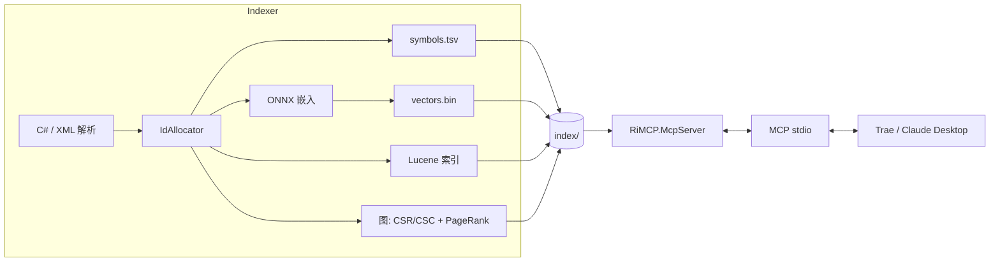

# RiMCP_v2

**[简体中文](README.md)** | [English](README.en.md)

RimWorld 代码索引 + MCP 服务器，用于 AI 辅助 Mod 开发。

扫描反编译的 RimWorld 源码与 XML Def，构建可检索索引（符号、稠密向量、Lucene、知识图谱），并通过 **Model Context Protocol (MCP)** 提供给 AI 编码助手调用——支持 Trae、Claude Desktop 等 MCP 客户端。

> **版本 0.1.0** · .NET 8 · MIT License

> **📦 前置下载（强烈推荐）**
>
> | 依赖 | 下载链接 | 说明 |
> |------|---------|------|
> | .NET 8 SDK | `https://dotnet.microsoft.com/download` | 必须 |
> | CUDA Toolkit 13.0 | `https://developer.nvidia.com/cuda-13-0-0-download-archive` | GPU 加速必须 |
> | cuDNN 9 for CUDA 13 | `https://developer.nvidia.com/cudnn` | GPU 加速必须（需注册） |
> | ILSpy（反编译工具） | `https://github.com/icsharpcode/ILSpy/releases` | 准备 RimWorldData 必须 |
> | RimWorld（Steam） | `https://store.steampowered.com/app/294100/RimWorld/` | 游戏本体 |
> | e5-base-v2 模型（HuggingFace） | `https://huggingface.co/intfloat/e5-base-v2` | ONNX 转换源（脚本自动下载） |

## 硬件兼容性

| 硬件 | GPU 加速 | 索引构建耗时 |
|------|---------|-------------|
| NVIDIA 显卡（6GB+） | ✅ CUDA | 约 40 分钟 - 1 小时 |
| AMD / Intel 独显 | ⚠️ DirectML（实验性） | 约 1-2 小时 |
| 核显 / 纯 CPU | ❌ | 约 2-5 小时 |

> 注：日常搜索/查询在所有硬件上都是**毫秒级**，只有首次构建索引时间不同。
> **DirectML 后端为实验性功能，未经完整测试。AMD / Intel 显卡用户如遇问题，请提 issue 反馈。**

### 索引构建时间参考

| 硬件 | 推荐 batch | 大约耗时 |
|------|-----------|---------|
| RTX 2060 6GB（笔记本 90W） | 64 | **约 40 分钟**（实测） |
| RTX 3060 12GB | 128 | 约 25 分钟 |
| RTX 4060 8GB | 64 | 约 30 分钟 |
| RTX 4090 24GB | 256 | 约 15 分钟 |
| AMD / Intel 独显（DirectML） | 32 | 约 1-2 小时 |
| 纯 CPU | 16 | 约 2-5 小时 |

> 以上为 15 万符号的参考值。显存不足时程序会报错，请降低 batch 重试。

## 特性

- **8 个 MCP 工具**，覆盖代码检索与图查询（见下表）。
- **语义搜索** — ONNX 嵌入（e5-base-v2，768 维），**CUDA 加速**。
- **混合检索** — Lucene 粗筛 + 向量重排。
- **知识图谱** — C# 引用、XML Def、继承关系与 PageRank（287,766 条边）。
- **索引约 151,812 个符号**（C# 源码 + XML Def），单次构建 **约 40 分钟**。
- 支持 `--graph-only` 按需重建图（**约 40 秒**，无需重跑嵌入）。

## 架构



## 快速开始

> **推荐一键安装：双击 `scripts/install.bat`** — 自动检测环境、准备模型、引导 RimWorldData、编译、构建索引，并生成你的 `mcp.json`。

### 主路径 — 一键安装

双击 `scripts/install.bat`（或运行 `scripts/install.ps1`），按提示操作即可。重复安装时建议保留 `index/` 与 `models/`，仅在需要干净重建时才重跑。

### 副路径 — 手动步骤

1. **前置要求** — .NET 8 SDK、CUDA 13.0 + cuDNN 9、RimWorld 游戏本体（用于提取源码）。
2. **Clone 仓库**。
3. **准备 `RimWorldData/`** — 复制游戏的 `Data` 目录；用 ILSpy 将 `Assembly-CSharp.dll` 反编译到 `RimWorld_Decompiled/Assembly-CSharp`。
4. **获取 ONNX 模型**（e5-base-v2，见 [models/README.md](models/README.md)）。
5. **构建**：`dotnet build`
6. **构建索引**（约 40 分钟）：`dotnet run --project src/RiMCP.Indexer`
7. **配置 MCP 客户端**（`mcp.json`）指向 `src/RiMCP.McpServer`（见下方示例）。

## MCP 工具

所有数据以 JSON 形式返回在 `content.text`。图工具支持 `maxResults`（默认 20，范围 1-100）限制返回条数。

| 工具 | 说明 | 示例 |
|------|------|------|
| `search_rim_world_code` | Lucene 粗筛 + 向量重排，返回前 3-5 条 | `{"query":"Door","maxResults":5}` |
| `get_rim_world_source` | 按符号读取源码，自动清理反编译注释 | `{"symbol":"Verse.Thing","maxLines":60}` |
| `search_symbol` | exact / prefix / fuzzy 符号查找 | `{"name":"Need_Food","matchMode":"prefix"}` |
| `get_rim_world_stats` | 索引统计 | `{}` |
| `get_rim_world_uses` | 下游：某符号依赖了谁（按 PageRank 排序） | `{"symbol":"Verse.Thing"}` |
| `get_rim_world_used_by` | 上游：谁引用了某符号 | `{"symbol":"Verse.Def","maxResults":100}` |
| `get_rim_world_inheritors` | 继承树，`direction` down/up | `{"symbol":"RimWorld.Building","direction":"down"}` |
| `list_defs` | 列出某类 Def | `{"defType":"ThingDef","maxResults":20}` |

### `mcp.json` 示例

```jsonc
{
  "mcpServers": {
    "rimcp": {
      "command": "dotnet",
      "args": ["run", "--project", "F:/KXMOD/RiMCP_v2/src/RiMCP.McpServer"],
      "env": {
        "RIMCP_ROOT": "F:/KXMOD/RiMCP_v2",
        "RIMCP_MODEL_PATH": "F:/KXMOD/RiMCP_v2/models/e5-base-v2-onnx"
      }
    }
  }
}
```

## 常见问题

- **CUDA 版本不匹配** — 可在配置里设 `OnnxProvider=cpu`，或安装与 ONNX Runtime GPU 版本匹配的 CUDA/cuDNN。
- **显存不足** — 调低 `RiMCP.Indexer/Config/IndexerConfig.cs` 里的嵌入 `BatchSize`。
- **索引构建慢** — 约 40 分钟大头在 ONNX 嵌入；如需重构图，用 `--graph-only` 约 40 秒即可。

## 开发者指南

- `src/RiMCP.Core` — 共享数据层（符号、向量、build.json、路径）。
- `src/RiMCP.Indexer` — 索引流水线（`--dry-run` / `--max-entries` / `--graph-only`）。
- `src/RiMCP.CoreTests` — 数据层测试。
- 跑测试：`dotnet test`。

## 致谢

本项目基于 / 包含以下项目的代码：

- `https://github.com/h7lu/RiMCP_hybrid` — MIT License
  (本项目 C# 解析、图关系构建、Lucene 索引等部分代码参考/移植自该项目)
- `https://huggingface.co/intfloat/e5-base-v2` by Microsoft Research — MIT License
  (嵌入模型)
- `https://lucenenet.apache.org/` — Apache 2.0 License
- `https://onnxruntime.ai/` — MIT License
- `https://modelcontextprotocol.io/` — MIT License

完整的第三方许可信息见 `THIRD_PARTY_LICENSES/` 目录。
部分源码文件顶部标注了来源于 RiMCP_hybrid 的版权信息。

## 开发说明

本项目在开发过程中使用了 AI 编程助手（Trae + DeepSeek-V4）辅助，包括：
- 代码框架设计和初始脚手架
- 部分模块实现
- 文档撰写
- Bug 修复和重构

所有代码均经过人工审核、编译验证、实测运行。
项目的整体架构、技术选型和功能设计由作者主导。

## License

[MIT](LICENSE) © KralisXC